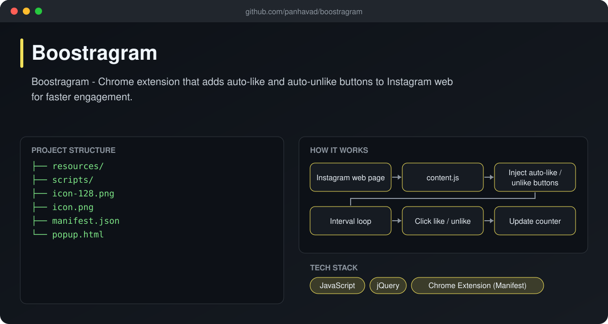
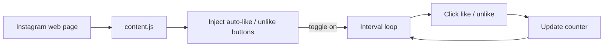

# Boostragram

  [](https://github.com/panhavad/boostragram/releases/latest)

**Boostragram** is a Chrome extension that adds **auto-like** and **auto-unlike** toggle buttons to Instagram web, with live counters, so you can work through a feed faster.



## Features

- Injects Like / Unlike buttons into Instagram
- Toggle on/off with icon state
- Configurable interval and counters
- Plain JavaScript + jQuery content script

## How it works



## Getting started

1. Download the release zip and unzip it.
2. Open `chrome://extensions`, enable **Developer mode**.
3. Click **Load unpacked** and pick the folder.

## Download

Grab the packaged source from the [latest release](https://github.com/panhavad/boostragram/releases/latest).

## Tech stack

- JavaScript
- jQuery
- Chrome Extension (Manifest)

## Project structure

```text
boostragram/
├── docs/
├── resources/
├── scripts/
├── icon-128.png
├── icon.png
├── manifest.json
├── popup.html
└── README.md
```
